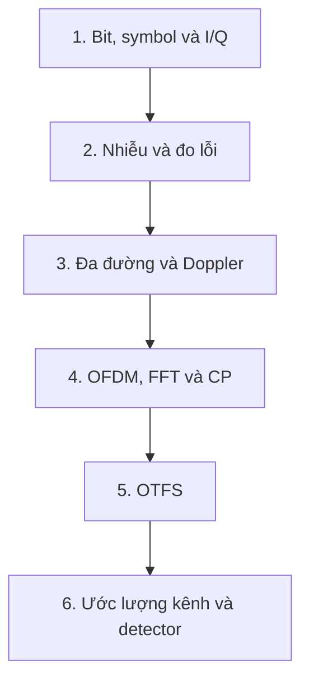

# Lộ trình học Digital Communications cho project OTFS trên FPGA

**Project:** DE2-115 + USRP N210, ưu tiên Verilog.  
**Cập nhật:** 29/10/2026.  
**Nguồn video:** [Digital Communications — Prof. Iain Collings](https://www.iaincollings.com/digital-communications).

Lộ trình gồm **23 video cốt lõi và 2 video bổ sung**, được chọn theo nhu cầu của project. Thứ tự, bài thực hành và tiêu chí chuyển chặng dưới đây là đề xuất học tập, không phải giáo trình chính thức của tác giả. Đây là lựa chọn dựa trên danh mục video đã kiểm tra, không phải đánh giá toàn bộ nội dung từng video.

Học song song với [PLAN và SPECS của project](README.md). Không cần xem hết rồi mới bắt đầu mô phỏng; mỗi chặng cần tạo ra kết quả nhỏ có thể kiểm tra. Chưa chốt lịch theo tuần vì thời gian học thực tế và deadline chưa được xác nhận.



## 1. Bit, symbol, I/Q và truyền tín hiệu

Mục tiêu: hiểu FPGA xử lý những con số gì và USRP đưa chúng ra đường truyền như thế nào.

| Xong | # | Video | Câu hỏi cần trả lời |
|---|---:|---|---|
| ☐ | 1 | [How is Data Sent?](https://youtu.be/MAddbFfCsIo) | Bit đi qua những bước nào trước khi phát? |
| ☐ | 2 | [How is Data Received?](https://youtu.be/hz6zhaCajnI) | Bộ thu làm gì để lấy lại bit? |
| ☐ | 3 | [What is a Constellation Diagram?](https://youtu.be/kfJeL4LQ43s) | Một điểm constellation biểu diễn điều gì? |
| ☐ | 4 | [Is the Imaginary Part of QAM Real?](https://youtu.be/6asDtzaVjbQ) | Phần “ảo” có ý nghĩa vật lý thế nào? |
| ☐ | 5 | [What is a Baseband Equivalent Signal in Communications?](https://youtu.be/etZARaMNN2s) | Vì sao mô hình băng gốc biểu diễn được tín hiệu vô tuyến? |
| ☐ | 6 | [How are Complex Baseband Digital Signals Transmitted?](https://youtu.be/0lkRJgnywkg) | Các mẫu I/Q được đưa ra đường truyền ra sao? |

**Thực hành:** ánh xạ `00 01 11 10` thành bốn điểm QPSK bằng Python/MATLAB, vẽ constellation rồi giải ánh xạ về bit. Dùng đúng bảng mapping trong README.

**Tiêu chí chuyển chặng:** phân biệt bit, symbol và sample; giải thích được vì sao I/Q 16+16 bit không đồng nghĩa một mẫu mang 32 bit thông tin người dùng.

**Liên hệ project:** `qpsk_mapper.v`, định dạng I/Q, ranh giới giữa xử lý số DE2-115 và RF N210.

## 2. Nhiễu, quyết định ký hiệu và đo lỗi

| Xong | # | Video | Câu hỏi cần trả lời |
|---|---:|---|---|
| ☐ | 7 | [What is White Gaussian Noise?](https://youtu.be/QfUQMzHfbxs) | Mô hình nhiễu được thêm vào tín hiệu thế nào? |
| ☐ | 8 | [What are SNR and Eb/No?](https://youtu.be/bNYvXr6tzXQ) | SNR và năng lượng trên mỗi bit khác nhau thế nào? |
| ☐ | 9 | [What Does a Digital Detector Do?](https://youtu.be/XzoLe9ixAZs) | Bộ thu quyết định ký hiệu từ điểm nhận bị lệch thế nào? |
| ☐ | 10 | [How are BER and SER Related?](https://youtu.be/du-sExIUV-Y) | Sai một symbol có nhất thiết sai một bit không? |

Nếu Gaussian còn mới, ôn trung bình, phương sai và phân phối chuẩn trước video 7.

**Thực hành:**

```text
Bits → QPSK → cộng nhiễu → quyết định ký hiệu → Bits
                                                ↓
                                           Tính BER
```

Tăng nhiễu, quan sát constellation và vẽ BER theo SNR. Lưu seed, số bit và số lỗi. Không diễn giải zero observed errors thành BER tuyệt đối bằng 0.

**Tiêu chí chuyển chặng:** giải thích được cách sinh nhiễu, công suất tín hiệu, quy tắc quyết định và phép đếm lỗi.

**Liên hệ project:** `qpsk_demapper.v`, `bit_error_counter.v`, scoreboard và mô hình AWGN.

## 3. Đa đường, fading và Doppler

| Xong | # | Video | Câu hỏi cần trả lời |
|---|---:|---|---|
| ☐ | 11 | [What is Intersymbol Interference — ISI?](https://youtu.be/I087FUvW2ys) | Vì sao các ký hiệu ảnh hưởng lẫn nhau? |
| ☐ | 12 | [What are Flat Fading and Frequency Selective Fading?](https://youtu.be/KiKPFT4rtHg) | Khi nào các thành phần tần số bị ảnh hưởng khác nhau? |
| ☐ | 13 | [What are Doppler Shift, Doppler Spread, and Doppler Spectrum?](https://youtu.be/LLr3-kotbz4) | Dịch tần chung khác gì Doppler khác nhau trên nhiều đường? |

**Thực hành:** bắt đầu bằng mô hình hai đường:

```text
y[n] = x[n] + 0.5*x[n-d]
```

Thay đổi d, quan sát tín hiệu và kết quả thu. Sau đó nhân một đường với hệ số quay pha `exp(j*2*pi*nu*n/Fs)` để thêm dịch tần.

**Tiêu chí chuyển chặng:** chỉ ra được delay, gain và Doppler trong mô hình; biết mô hình này là minh họa có kiểm soát, chưa phải mọi đặc tính của một kênh thực.

**Liên hệ project:** channel emulator ở G1/G7. Hiểu từng thành phần trước khi dùng một hàm fading channel có nhiều tham số.

## 4. OFDM, FFT/IFFT và cyclic prefix

Đây là nền tảng quan trọng trước khi đọc sâu các diagram OTFS trong bài báo.

| Xong | # | Video | Câu hỏi cần trả lời |
|---|---:|---|---|
| ☐ | 14 | [What is OFDM? And Why is it Used?](https://youtu.be/-xdcndtzrFc) | Vì sao chia dữ liệu lên nhiều sóng mang? |
| ☐ | 15 | [OFDM Waveforms](https://youtu.be/F6B4Kyj2rLw) | Dạng sóng tổng hợp hình thành thế nào? |
| ☐ | 16 | [OFDM and the DFT](https://youtu.be/Z4LIgNgNAlI) | Vì sao TX dùng IFFT, RX dùng FFT? |
| ☐ | 17 | [How are OFDM Subcarrier Spacing and Time Samples Related?](https://youtu.be/knjeXo3VZvc) | Fs, kích thước FFT và khoảng cách sóng mang liên hệ thế nào? |
| ☐ | 18 | [What is a Cyclic Prefix in OFDM?](https://youtu.be/AJg57AEBtNw) | CP lấy từ đâu và có mục đích gì? |
| ☐ | 19 | [Why is Doppler a Problem for OFDM?](https://youtu.be/mB0GF9uKC48) | Chuyển động ảnh hưởng tính trực giao thế nào? |

**Thực hành bắt buộc trước OTFS:**

```text
QPSK → IFFT → thêm CP → kênh → bỏ CP → FFT → khôi phục QPSK
```

Lần lượt thử identity, AWGN rồi đa đường. Với đa đường, thêm equalization phù hợp; không mặc định chỉ bỏ CP là đủ khôi phục dữ liệu.

**Tiêu chí chuyển chặng:** với Fs = 2 MS/s, M = 128 và CP = 16 mẫu, tự tính và giải thích:

- Khoảng cách sóng mang: 15,625 kHz.
- Thời gian hữu ích: 64 µs.
- Thời gian CP: 8 µs.

**Liên hệ project:** `fft_engine_wrap.v`, `cp_insert.v`, `cp_remove.v`, RAM và ordering. Nếu chỉ gọi được hàm FFT mà chưa giải thích input/output của nó trong OFDM, cần thực hành thêm.

## 5. OTFS và đối chiếu bài báo

- [ ] **20. [What is OTFS? Orthogonal Time Frequency Space Modulation](https://youtu.be/MvK3zhPrGkk)**

Đặt Fig. 1 và Fig. 2 của bài *FPGA Implementation of OTFS Modulation for 6G Communication Systems* bên cạnh để nối kiến thức với kiến trúc:

```text
QPSK symbols
      ↓
Lưới delay–Doppler
      ↓ ISFFT
Lưới thời gian–tần số
      ↓ Xử lý phát
Mẫu tín hiệu theo thời gian
```

**Thực hành:** dùng lưới 16 × 8, viết TX/RX floating-point cho kênh lý tưởng. In kích thước mảng, tên trục và thứ tự serialize tại từng bước. Dùng quy ước README để tránh nhầm chỉ số giữa các tài liệu.

**Tiêu chí trước khi viết RTL OTFS:**

- [ ] Biết mỗi chiều ma trận biểu diễn gì.
- [ ] Biết FFT/IFFT thực hiện theo chiều nào.
- [ ] Biết thứ tự đọc ma trận thành mẫu thời gian.
- [ ] Khôi phục đúng bit ở kênh lý tưởng.
- [ ] Ghép được từng khối model với sơ đồ bài báo.
- [ ] Hiểu điều kiện áp dụng đường full và đường reduced trong README.

Có thể xem video này sớm một lượt để hình dung mục tiêu, rồi học kỹ lại sau chặng OFDM.

## 6. Ước lượng kênh, equalization và detector

| Xong | # | Video | Mục tiêu học |
|---|---:|---|---|
| ☐ | 21 | [Channel Estimation for Mobile Communications](https://youtu.be/ZsLh01nlRzY) | Vai trò training/pilot |
| ☐ | 22 | [How are Matched Filter, ZF, and MMSE Related?](https://youtu.be/U3qjVgX2poM) | Cách xử lý tín hiệu thu và ảnh hưởng của nhiễu |
| ☐ | 23 | [How are Different Equalization Methods Related?](https://youtu.be/hYNwTTWrp48) | Tổng quan trước khi chọn receiver |

**Thực hành:** cấp kênh chính xác cho receiver trước; sau đó thay bằng kênh ước lượng từ training. So sánh BER và sai số ước lượng, giữ nguyên các điều kiện khác.

**Tiêu chí:** phân biệt lỗi transform, lỗi đồng bộ, lỗi CSI và lỗi detector. Các video cung cấp nền tảng; detector OTFS cụ thể vẫn phải phù hợp biến thể CP và channel model của project.

**Liên hệ project:** receiver trên PC ở G6/G7; detector FPGA ở nhánh G9B. Có thể học chặng này song song với RTL transforms, chưa cần chuyển estimator/detector lên FPGA ngay.

## 7. Hai video bổ sung

| Xong | Video | Thời điểm |
|---|---|---|
| ☐ | [What is PAPR? And its Relationship to OFDM](https://youtu.be/F4LAZTdm_b8) | Trước thử N210 và khi khảo sát clipping/fixed-point |
| ☐ | [Delay Doppler, Zak-OTFS, and Pulse Shaping Explained](https://youtu.be/v0eo2XqQftA) | Sau khi chạy được OTFS cơ bản, để mở rộng hiểu biết về dạng sóng |

Phần Coding and Decoding, MIMO/beamforming, NOMA và mmWave có thể học sau: cấu hình ban đầu là SISO, QPSK, chưa có FEC.

## 8. Kiến thức cần học riêng

| Nhóm | Nội dung | Liên hệ |
|---|---|---|
| Toán và DSP | Số phức, ma trận, DFT/FFT, sampling, tích chập | Hiểu model và transforms |
| Fixed-point | Signed arithmetic, width growth, rounding, saturation, scaling | G2 và đánh giá sai số RTL |
| RTL | FSM, RAM/FIFO, pipeline, valid/ready, clock/reset | G3–G5 |
| Verification | Test vectors, scoreboard, backpressure, reset giữa frame | Chứng minh module hoạt động đúng |
| RF/SDR | Đồng bộ thời gian, CFO, rate conversion, UHD | G6/G7 với N210 |

Xem hết video không tự bảo đảm đã nắm chắc đề tài. Bằng chứng hiểu là tự giải thích và kiểm tra được một mô hình nhỏ.

## 9. Cách học và ghi nhớ

Mỗi chặng tạo ba sản phẩm:

1. **Sơ đồ tự vẽ:** đầu vào, đầu ra và chức năng từng khối.
2. **Mô phỏng nhỏ:** code có thể tự giải thích từng bước, dùng seed xác định.
3. **Phép kiểm tra:** có kết quả mong đợi và điều kiện PASS/FAIL.

Sau mỗi video, ghi lại:

```text
Tên video:
Vấn đề nó giải quyết:
Vị trí trong hệ thống:
Input / output:
Công thức hoặc ví dụ chính:
Liên hệ module trong project:
Điều tôi chưa hiểu:
Bài kiểm tra tôi sẽ làm:
```

Ở buổi học kế tiếp, dành vài phút tự vẽ lại sơ đồ trước khi mở ghi chú. Nếu có Summary Sheet trên trang tác giả, dùng để đối chiếu sau khi tự nhớ lại.

## 10. Buổi học đầu tiên

- [ ] Xem video 1–3.
- [ ] Vẽ đường đi bit → symbol → tín hiệu → symbol → bit.
- [ ] Làm bảng QPSK bốn điểm theo README.
- [ ] Ánh xạ và giải ánh xạ chuỗi `00 01 11 10` bằng Python/MATLAB.
- [ ] Tự trả lời: “Từ hai bit 01, tôi tạo ra I/Q nào, và receiver quyết định lại hai bit đó bằng cách nào?”

Chưa cần FFT hoặc Verilog trong bài đầu tiên. Khi mapping/demapping đã rõ, có thể chuyển chính bài nhỏ này thành `qpsk_mapper.v` và testbench trước khi xây toàn bộ modem.
